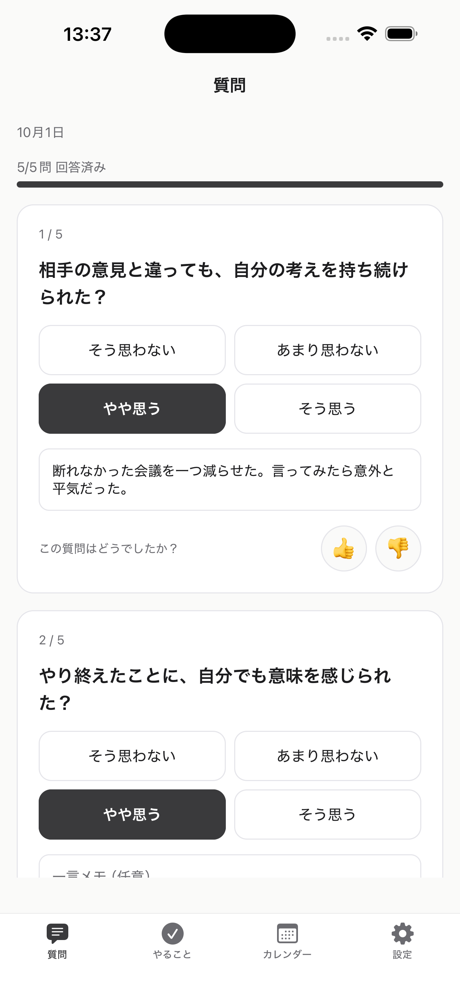
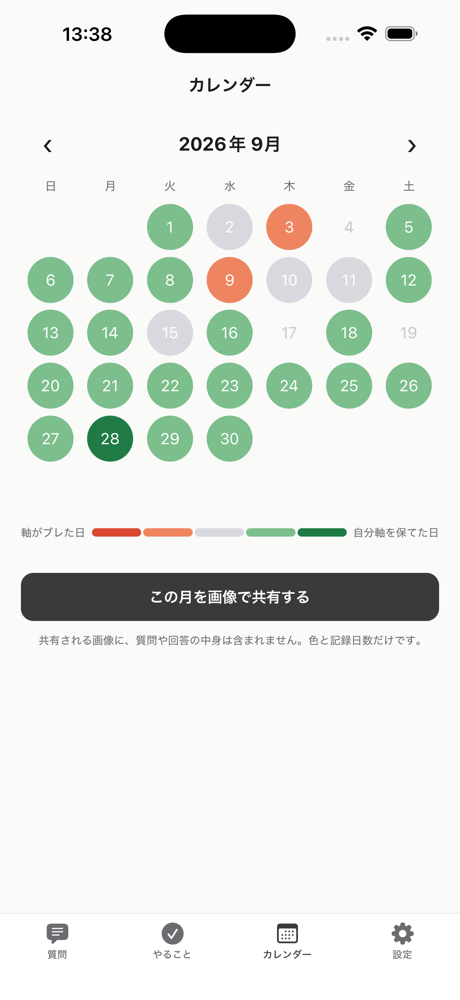
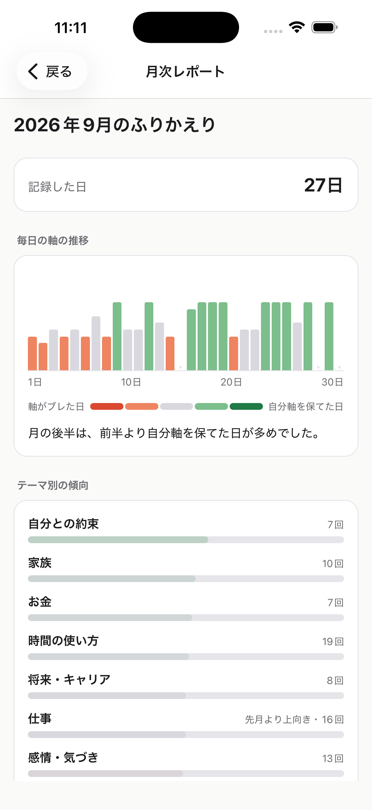

# キミシダイ日記

「今日一日を**自分軸**で生きられたか」を、日替わりの5つの質問に答える形で振り返るカレンダー型日記アプリ（iOS）。

アカウント登録はなく、**記録はすべて端末内に保存**されます。日記の内容が外部に送られることはありません。

| 今日の質問 | カレンダー | 月次レポート |
|---|---|---|
|  |  |  |

**ステータス**: v1.0.1 を App Store 審査に提出済み（2026-10-30）/ 配信地域は日本のみ

---

## 何を解決するアプリか

対象は「周りに合わせすぎている」と感じる20〜30代、なかでも **日記アプリを試したが続かなかった人** です。

この層は**責められると即座にアンインストールします**。そのため、アプリ全体の語り口を「断定・説教調を避け、責めない」で統一し、その方針を実装にも一貫させています。

- 回答UIには**スコアの高低を示す色を使わない** — 「良さそうな色」を選びたくなるバイアスを避けるため
- 月次レポートに**平均点を数字で出さない** — 低い月を突きつけると振り返り自体をやめてしまうため
- 共有画像に平均スコアを含めない — 同じ理由

## 主な機能

- **日替わりの5問**に4段階＋任意メモで回答 → 0〜100の「軸スコア」を算出
- **カレンダー**にスコアを5段階の色（暖色→緑）で表示
- **やること**リスト（完了時に「誰のためにやったか」を記録）
- **月次レポート**（買い切り「プラス」で解放。テーマ別の傾向を端末内で集計）
- 毎日のリマインダー（**ローカル通知のみ**。プッシュ基盤を持たない）
- カレンダーの画像共有（色と記録日数のみ。回答内容は含めない）

## 技術構成

| 領域 | 選定 |
|---|---|
| フレームワーク | React Native（Expo SDK 57）+ TypeScript |
| ルーティング | Expo Router（ファイルベース） |
| ローカルDB | expo-sqlite（生SQL + リポジトリ層、マイグレーション管理） |
| 課金 | RevenueCat（`react-native-purchases`）/ 買い切り1本 |
| 通知 | expo-notifications（ローカル通知のみ） |
| 画像共有 | react-native-view-shot + expo-sharing |
| ビルド・配信 | EAS Build / EAS Submit |

規模: **72ファイル / 約7,300行**（`app/` と `src/` の TypeScript）

## アーキテクチャ

役割ごとに5層に分け、**上の層はすぐ下の層だけを呼ぶ**構成にしています。

```
app/                     ① 画面（Expo Router）
src/components/          ② 見た目の部品（判断を持たない）
src/hooks/               ③ 状態の保持と更新
src/services/            ④ アプリのルール
src/db/repositories/     ⑤ SQL の実行と型変換
                              ↓
                           SQLite
```

**なぜ分けたか**：回答を保存できる画面が3つあります（今日の質問／完了後の見直し／日別詳細）。画面から直接DBを触れる設計にすると、「保存したらスコアとステータスを再計算する」というルールを3箇所に書くことになり、いつか必ず1箇所だけ直し忘れます。サービス層を必ず経由させることで、**このルールの記述は `dailyEntryService.ts` の1箇所だけ**になっています。

この設計の効果は実際に確認できました。UI を全面的に作り替えた際（デザイントークン導入・アクセシビリティ改善）、**フック・サービス・リポジトリの3層は1行も変更していません**。

## 設計上の判断

判断の理由は [`PROJECT_STATE.md`](PROJECT_STATE.md) に記録しています。特に重要な3つ:

**1. TODO の達成率を軸スコアに反映しない**

数値が取れるので反映したくなりますが、4つの例で検証したところ3つで判定が壊れました。最も分かりやすいのは**上司に積まれた仕事を全部こなした日**で、機械的には満点になりますが、このアプリが検出したい「他人軸」そのものです。代わりに「誰のためにやったか」を本人に選んでもらう形にしました。問いを立てること自体が振り返りの仕掛けになるためです。

**2. 質問選出で polarity のバランスを取る**

単純ランダムだと「〜してしまった？」という否定形の質問が5問並ぶ日が発生しました（実測）。5問連続で失敗を問われる体験は「責めない」方針から外れるため、positive / negative を交互に選ぶ実装にしています。10,000回のシミュレーションで、必ず positive 2〜3問 / negative 2〜3問に収まることを確認済みです。

**3. 買い切りに AI 機能を含めない**

買い切りは一度きりの収入なので、利用のたびに費用が発生する機能を含めると、使われるほど赤字になります。買い切りの特典は**端末内で完結してコストが増えない機能**（月次レポート、履歴の全期間表示）に限定しています。

## 開発について

**Claude Code を使って開発しています。** コードの生成は AI に任せ、仕様と設計の判断は自分で行う分担です。却下した AI の提案と、その理由は `PROJECT_STATE.md` に残しています。

品質の担保は3つの手段で行っています。

1. TypeScript の型チェック（`npx tsc --noEmit`）を常に通す
2. 端末内のDBを直接開き、画面の操作と保存結果を突き合わせる
3. ロジックの正しさを**別の経路で検算**する（例: 軸スコアの計算を SQL で独立に書いて照合）

## セットアップ

```bash
npm install
npx expo start
```

`i` キーで iOS シミュレータが起動します。**外部APIキーの設定は不要**です（第0段階では AI を使用していないため）。

課金まわりの動作確認には RevenueCat の API キーが必要です。未設定の場合、購入画面は無効状態で表示されます。

## 現状の課題

ポートフォリオとして公開しているため、弱点も明記します。

- **テストコードがない** — 最優先の課題。外部依存のない純粋関数である `src/services/axisScore.ts` から着手する想定
- **CI がない** — 型チェックもビルドも手元でしか実行していない
- **Android 未検証** — コードは書いているが、実機・エミュレータでの確認ができていない
- **年次レポート未実装** — 1年分の記録が溜まったユーザーが出てから作る方針

## 関連リポジトリ

- 利用規約・プライバシーポリシーの公開ページ: [kimishidai-diary-legal](https://github.com/makeahistory164-bit/kimishidai-diary-legal)（[公開URL](https://makeahistory164-bit.github.io/kimishidai-diary-legal/)）
  - 本文の出典は `src/constants/legalDocuments.ts` の1箇所。`node scripts/build-legal-pages.mjs` で HTML を生成しており、アプリ内表示と公開ページの文面がずれない作りにしています

## ライセンス

個人開発プロジェクトです。コードの再利用は想定していません。
